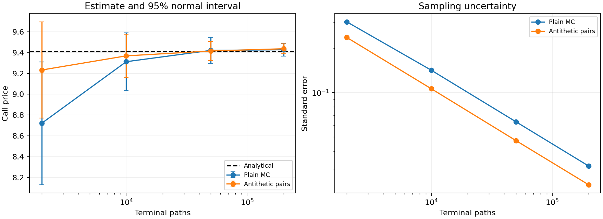
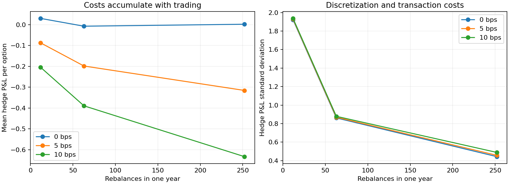

[](https://github.com/Mingju-Zhang-CBS/derivatives-pricing-lab/actions/workflows/checks.yml)

[Research Studio](https://github.com/Mingju-Zhang-CBS) · [Research directory](https://github.com/Mingju-Zhang-CBS/Quant)

# Derivatives Pricing Lab

**Research question:** How do numerical uncertainty, discrete hedging error and trading costs interact in a transparent option model?

This project connects analytical European option prices and Greeks to Monte Carlo estimates and a self-financing short-option hedge. It uses the published Black-Scholes-Merton model, declared parameters and common simulated stock paths.

**Python 3.12 · NumPy · SciPy · 8 local tests passed · Simulated paths · MIT**

## Read the result first

For a one-year ATM option with `S = K = 100`, continuously compounded `r = 3%`, `sigma = 20%` and zero dividends, the analytical call price is **9.413403** and put price is **6.457957**.

| 200,000 terminal paths | Estimate | Standard error | Absolute error in this run |
| --- | ---: | ---: | ---: |
| Plain Monte Carlo | 9.428070 | 0.031761 | 0.014666 |
| Antithetic pairs | 9.437465 | 0.023705 | 0.024062 |

**Research interpretation:** antithetic sampling reduces estimated standard error by **25.4%** at the same terminal-path count, but its point estimate happens to be farther from the analytical price for this seed. Lower sampling variance does not guarantee lower realized error in every run.



## What this project demonstrates

| Skill | Concrete evidence |
| --- | --- |
| Mathematical finance | Risk-neutral valuation, continuous dividend yield, put-call parity and analytical sensitivities. |
| Numerical methods | Vectorized formulas, limiting cases, finite differences and online centered moments. |
| Statistical simulation | Independent antithetic pair means, standard errors and uncertainty intervals. |
| Risk and hedging | Self-financing stock/cash evolution with inception, rebalance and liquidation costs. |
| Experimental design | Common underlying paths across nine rebalancing/cost configurations. |
| Performance engineering | A declared 10,000-option batch workload, seven warm measurements and sampled process memory. |

## The complete research workflow


1. **State the model and units.** Prices accept spot, strike, annual continuous rates, volatility, maturity and continuous dividend yield.
2. **Compute a reference.** Evaluate vectorized analytical call/put prices and Greeks; check parity, known prices and boundary behavior.
3. **Sample terminal payoffs.** Generate risk-neutral terminal GBM values, discount payoffs and combine batch moments without storing every payoff.
4. **Respect the sampling unit.** In antithetic mode, average the `Z` and `-Z` payoff legs first; each pair is one independent observation.
5. **Run a discrete hedge.** Sell one option, buy delta stock, fund the difference in cash and update only at observed grid times.
6. **Compare fixed cases.** Use the same 6,000 underlying paths for 12, 63 or 252 rebalances and 0, 5 or 10 bps costs.

### Why pair-based uncertainty matters

```text
Pair observation = [discounted payoff(Z) + discounted payoff(-Z)] / 2
Standard error   = standard deviation(pair observations) / sqrt(number of pairs)
```

At 200,000 terminal paths, antithetic mode has **100,000 independent pair observations**. The test suite reconstructs those pair payoffs independently and checks the reported mean and standard error.

## The hedging tradeoff



| Rebalances in one year | P&L standard deviation, zero cost | Mean P&L at 5 bps |
| --- | ---: | ---: |
| 12 | 1.9222 | -0.0875 |
| 63 | 0.8614 | -0.1985 |
| 252 | 0.4430 | -0.3156 |

Amounts are currency units per short option. Finer hedging reduces ideal-model discretization risk in this experiment, while repeated trading lowers mean P&L when costs apply. The [worked walkthrough](docs/WALKTHROUGH.md) derives the initial cash position, a one-step hedge and the terminal settlement.

## Reproduce the study

```text
python -m venv .venv
```

Activate the environment with `.venv\Scripts\Activate.ps1` in Windows PowerShell, or `source .venv/bin/activate` on macOS/Linux. Then:

```text
python -m pip install -r requirements.lock.txt
python -m pip install --no-deps -e .
python -m pytest
python -m pricing_lab --output local-runs/demo
```

Use Python 3.12 and a new or empty output directory. After dependencies are installed, the synthetic demonstration needs no network access. The checked-in run is in `reports/demo/`; new runs go to ignored `local-runs/`.

### Use the Python interface

```python
from pricing_lab.core import price, greeks, monte_carlo

call = price(100, 100, 0.03, 0.20, 1.0)
sensitivities = greeks(100, 100, 0.03, 0.20, 1.0)
estimate = monte_carlo(100, 100, 0.03, 0.20, 1.0,
                       paths=200_000, seed=42, antithetic=True)
```

Vega and rho are per unit decimal change; divide by 100 for a one-percentage-point change. Theta is per year of calendar-time passage. Prices support expiry and zero volatility; Greeks deliberately require strictly positive maturity and volatility.

## Engineering map and verification

| Implementation | Responsibility |
| --- | --- |
| [`core.py`](pricing_lab/core.py) | Prices, Greeks, Monte Carlo, GBM paths and self-financing hedge P&L. |
| [`__main__.py`](pricing_lab/__main__.py) | Fixed simulation study, timing workload, CSV artifacts, figures and report. |
| [`test_pricing.py`](tests/test_pricing.py) | Independent numerical identities, pair variance, cash-flow checks and invalid simulation inputs. |

Tests cover call/put parity, a known reference value, central-difference Greeks, scalar simulation contracts, valid rebalance grids and the effect of costs on identical paths. Each run saves `monte_carlo.csv`, `hedging.csv`, `metrics.json`, `manifest.json` and `REPORT.md`.

The benchmark prices a fixed vectorized batch of 10,000 options after warmup, using the median of seven timings. The recorded environment and elapsed times are in [metrics](reports/demo/metrics.json) and the [manifest](reports/demo/manifest.json). This is a local numerical workload, not exchange latency or a production SLA.

## Assumptions and limits

- Simulations follow a constant-volatility GBM model; numerical agreement does not validate the model against market quotes.
- Pricing supports continuous dividend yield, while the hedging experiment assumes zero dividends.
- There are no jumps, stochastic volatility, margin constraints, financing spreads or market impact.
- Monte Carlo intervals are approximate sampling intervals for a fixed configuration; individual realizations can miss the reference.
- A single seed is illustrative. Hedging P&L and timing are conditional on the declared paths, model and machine.

## Explore the evidence

| Read | Purpose |
| --- | --- |
| [Worked walkthrough](docs/WALKTHROUGH.md) | Follow the research logic and a numerical example. |
| [Methods and input contract](docs/METHODS.md) | Check assumptions, conventions and supported interfaces. |
| [Executed research report](reports/demo/REPORT.md) | Inspect the recorded results and limitations. |
| [Interview discussion](docs/INTERVIEW.md) | Practice explaining decisions and failure modes. |
| [Resume evidence](docs/RESUME.md) | Trace draft claims to measured artifacts. |
| [Provenance](docs/PROVENANCE.md) | Understand attribution, AI assistance and data rights. |

The implementation and documentation were developed with AI assistance from public mathematical methods. No classroom solution files, company code or market-data snapshots are included. [MIT license](LICENSE).
