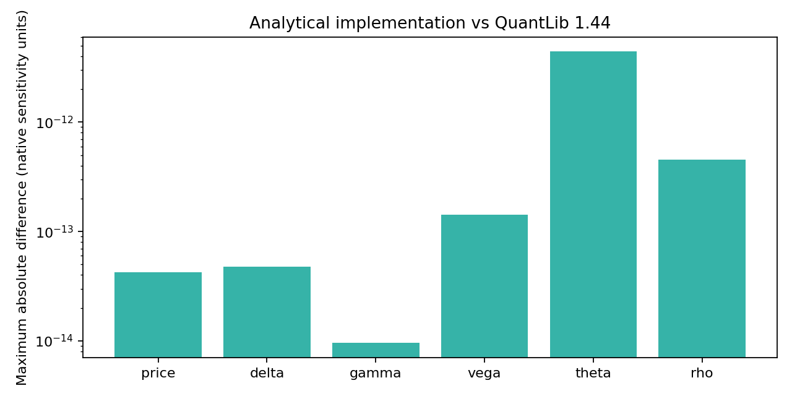

# Derivatives Pricing Lab

How do numerical error, discrete hedging and contract conventions affect a European option valuation? The lab connects Black–Scholes–Merton prices and Greeks to an independent numerical reference, Monte Carlo estimates and a self-financing short-option hedge.

**Finding.** Across **1,296 predetermined European call and put cases**, the maximum absolute price difference versus **QuantLib 1.44** was **4.263 × 10⁻¹⁴** in the grid's price units. The grid includes negative rates, one-day maturity, low and high volatility, and nonzero continuous dividends. This is a numerical consistency check in a common model.

[Numerical comparison](reports/quantlib/REPORT.md) · [Hedging results](reports/demo/REPORT.md) · [Run the study](#run-the-study)



*Deterministic grid. Each Greek difference is reported in its own sensitivity units. The [comparison report](reports/quantlib/REPORT.md) documents normalization and tolerances.*

## Pricing and hedging under declared assumptions

- **Monte Carlo.** At 200,000 terminal paths, antithetic sampling reduces the estimated standard error from 0.031761 to 0.023705 in the fixed ATM call example. Its realized error is larger for that seed. Each pair contributes one independent observation. [Convergence results](reports/demo/mc_convergence.png)
- **Discrete hedge.** Using common simulated paths, raising annual rebalances from 12 to 252 reduces zero-cost P&L standard deviation from 1.9222 to 0.4430 per short option. At 5 bps, mean P&L shifts from −0.0875 to −0.3156. [Hedge tradeoff](reports/demo/hedging_tradeoff.png) · [Cash-flow walkthrough](docs/WALKTHROUGH.md)
- **Contract and quote checks.** The SPX workflow matches security, date, expiry and settlement, then compares fixed lagged-volatility marks with closing bid/ask intervals. The public fixture uses synthetic quotes. Licensed historical inputs and derived results are held privately. [Quote methods](docs/QUOTE_RESEARCH.md) · [Fixture results](reports/quote-fixture/REPORT.md)

The hedge assumes constant-volatility GBM, zero dividends and a fixed transaction-cost schedule. Pricing supports continuous dividend yield. The simulations exclude market impact, margin constraints and stochastic volatility.

## Run the study

Use Python 3.12 from the repository root. Activate the virtual environment with `.venv\Scripts\Activate.ps1` in PowerShell or `source .venv/bin/activate` on macOS/Linux.

```bash
python -m venv .venv
# Activate the environment before installing.
python -m pip install -r requirements.lock.txt QuantLib==1.44 pyarrow==26.0.0
python -m pip install --no-deps -e .
python -m pip check
python -m pytest -q tests
python -m pricing_lab.diagnostics --benchmark --output local-runs/quantlib
python -m pricing_lab --output local-runs/demo
```

The grid and the simulation run offline after installation. Use fresh output directories. The public Python interface in [core.py](pricing_lab/core.py) exposes `price`, `greeks` and `monte_carlo`. [Methods](docs/METHODS.md) explain Greek units and boundary behavior. [Tests](tests/test_pricing.py) cover parity, central differences, sampling units and the hedge cash account.

[Technical discussion](docs/DISCUSSION.md) · [Attribution and AI assistance](docs/PROVENANCE.md) · [MIT license](LICENSE) · [Research directory](https://github.com/Mingju-Zhang-CBS/Quant)
