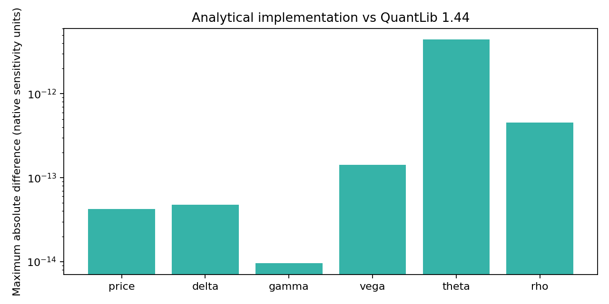

# Independent numerical comparison

**1,296 predetermined European call/put parameter cases**, including negative rates, one-day expiry, low/high volatility and nonzero continuous dividend yield. No market quotes are used here.

|Quantity|Maximum absolute difference|
|---|---:|
|price|4.263e-14|
|delta|4.78e-14|
|gamma|9.548e-15|
|vega|1.421e-13|
|theta|4.417e-12|
|rho|4.547e-13|

## Conventions

The local Black–Scholes–Merton functions are compared with QuantLib's `BlackCalculator`, using F=S*exp((r-q)T), discount=exp(-rT) and standard deviation=sigma*sqrt(T). This avoids accidental calendar/day-count differences. Vega and rho are per unit decimal input; theta is per year. A per-percentage-point vega is this vega divided by 100. The tolerance is 1e-8 in each native unit; relative error is not meaningful when the reference is near zero.

## What this establishes

Agreement checks one implementation against a mature, separately authored library. It does not establish that lognormal volatility, constant rates, continuous dividends or a synchronized forward describe a real quoted contract. The quote study separately measures distances from bid/ask intervals. Terminal and zero-volatility boundaries remain covered by the original unit tests.

Run `python -m pricing_lab.diagnostics --benchmark --output local-runs/quantlib` after `pip install ".[test,benchmark]"`. QuantLib is BSD-3-Clause licensed; its authorship and license remain with its maintainers. No upstream contribution is claimed. [Source and license](https://www.quantlib.org/license.shtml).
