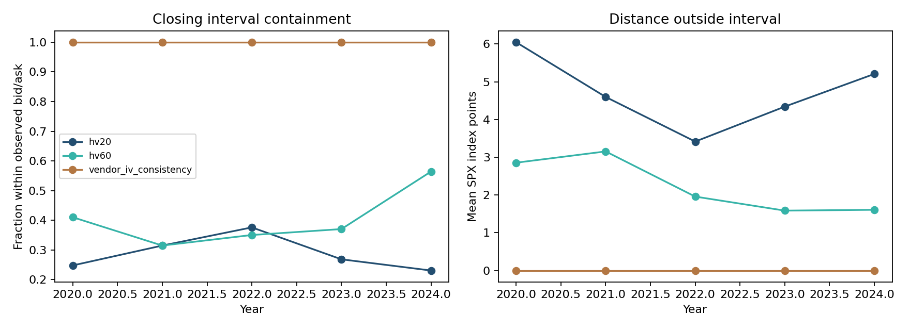
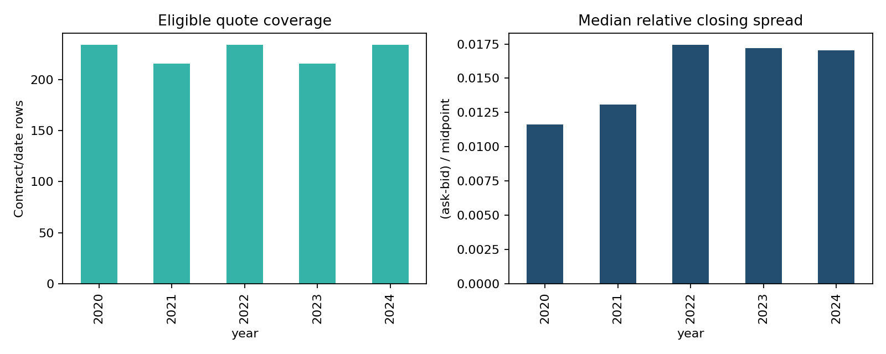

# SPX end-of-day valuation diagnostics

This run is based on the input kind in metrics.json. Real licensed records and derived results remain private pending the applicable publication-rights assessment. Synthetic fixtures establish implementation behavior only.

The models use lagged 20/60-session annualized log-return volatility, same-date vendor forward prices and same-date interpolated continuously compounded zero rates. Strike is divided by 1,000; rates by 100; premiums remain SPX index points. Contract dollar value is index points times 100. There is no ETF-per-share quote conversion. Positive vendor IV is optional and its reconstructed price is a circular consistency diagnostic, not an independent forecast. All fixed year/type/tenor slices and ordered exclusion counts are saved.

Development is 2020–2022, review is 2023 and historical confirmation is 2024. No volatility-window choice is selected using the review or confirmation outcomes. This is a predetermined valuation comparison rather than an options-return prediction task.

Missing forward/curve/history records, wrong settlement/type, wrong contract size, out-of-range moneyness and invalid intervals are explicitly excluded. Forward joins use security/date/expiration/AM-PM keys and reject duplicates. Bid/ask are closing cross-exchange observations; a positive bid is not evidence of executable depth. Data sources can have different EOD clocks. Our ACT/365 calendar-day maturity ignores hours and vendor-specific expiration handling; IV reconstruction discrepancies can expose these conventions rather than economic mispricing. No live quote, fill, queue, hedged profit or arbitrage claim follows from distance to a closing interval.

The protocol, source hashes, input hashes and output hashes identify this run. Raw contract results are saved separately from summary tables; both are private for licensed inputs. Public numerical-grid and synthetic-fixture reports carry their own labels.
